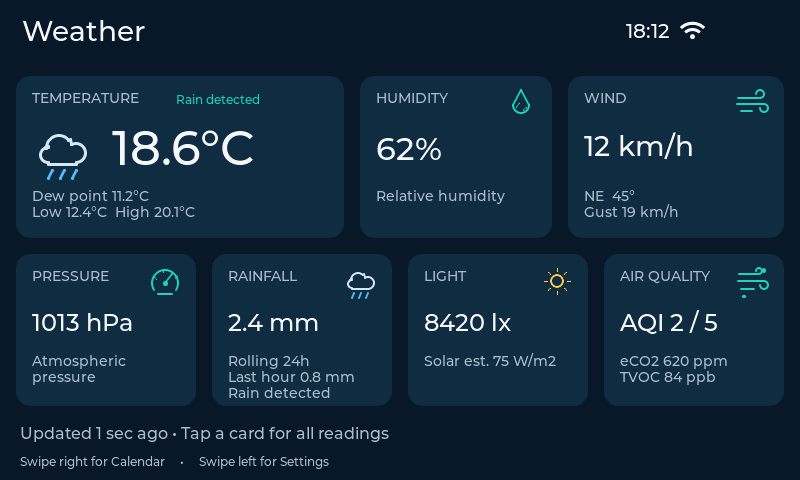
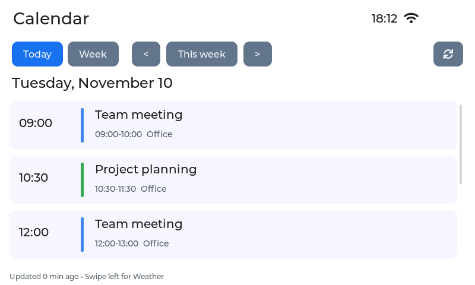
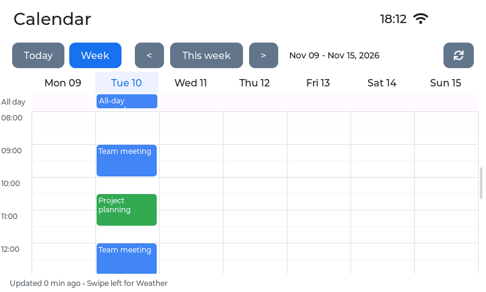
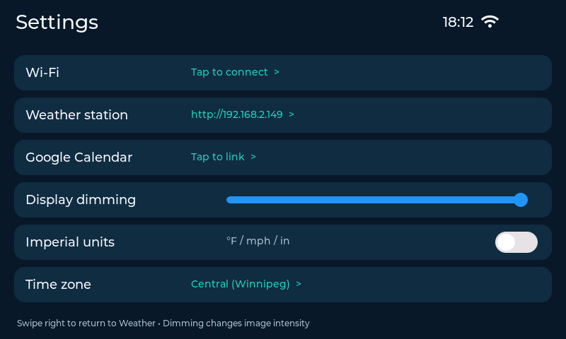

# Weather Display - Waveshare ESP32-S3 Touch LCD 7
This is built for the 800 × 480 touchscreen version and includes a dashboard that reads data from byte4geek's weather station (https://github.com/byte4geek/weatherstation) wirelessly and displays Google Calendar events on another screen. It boots straight into weather cards with swipe navigation to Calendar and Settings. Device configuration is saved between restarts. Use the touchscreen for settings or the Windows USB helper for Google Calendar credentials. Open this folder in VS Code with PlatformIO installed. Firmware version: 0.1.0, first hardware-test release.

## Navigation
The display boots straight into **Weather**. Swipe right from Weather for **Calendar**; swipe left from Weather for **Settings**. 

Weather cards show temperature, humidity, wind, pressure, rolling 24-hour rainfall, light, and ENS160 air quality. The main condition icon changes for detected rain, estimated sunny/partly cloudy/cloudy conditions, low light, or unavailable data. Sunny/cloudy choices are rough light-level estimates. Rain uses the station’s `is_raining` flag (rain detected within its last-five-minute window), rather than the day’s accumulated rainfall. The station cards use your existing weather station. The optional forecast and alert screens use public feeds. Stale data clears the main condition icon to unavailable. Tap a weather card to see its related readings. The display requests station readings on connection, when the station address changes, and every five minutes during normal operation. Failed requests retain the last known readings, which are marked stale after five minutes and 30 seconds without a successful update.

Calendar has a 'Today' agenda and a Week view. The week runs from Sunday through Saturday. Scroll vertically for the rest of the day; tap an event for details. Arrow buttons navigate weeks, and "This Week" will return to the current week. "Today" returns to today's agenda. Calendar sync runs automatically every five minutes. Tap Refresh to fetch the selected week on demand. After a manual refresh, the next automatic sync waits five minutes. The integration will support up to 100 events per week and up to 8 calendars. A Google Apps Script is provided using Google's Calendar API. The script is created and deployed within your local account; no data is stored in a configuration file. Enter the generated URL and token on the touchscreen or transfer them with the Windows USB helper.

### More weather screens

- **Today at a Glance** combines current station temperature and reported high/low with up to two remaining calendar events and four hourly forecasts.
- **Weather Trends** charts temperature, pressure, 10-minute gust, and rolling 24-hour rain from the display's five-minute station polls. Tap the chart to inspect a reading. History builds after time sync, leaves gaps for missing readings, and resets when the display restarts or the station address changes.
- **Weather Alerts** shows advisories, watches, warnings, and statements from the matched Environment Canada city page when available. The Weather Alerts shortcut highlights when fresh active alerts are present. The screen identifies unavailable or stale data. Keep your usual emergency alert channels.

Set **Settings → Postal code** for the forecast and alerts. Enter your Canadian postal code and tap **Save**. The display retains and sends only the first three characters to Zippopotam.us. It selects a nearby Environment Canada city page using the postal area's approximate coordinates and shows the matched location on both screens. A rural postal area can span multiple warning regions. Check the displayed region for your location. A blank field clears the location. This setting leaves the station address and clock time zone as configured.

Weather data source: [Environment and Climate Change Canada, City Page Weather](https://api.weather.gc.ca/collections/citypageweather-realtime).

### Print Room

Tap **Print Room** on the Weather dashboard for read-only printer progress, status, temperatures, and optional room sensors. Set up the local Home Assistant bridge and enter its address under **Settings → Print Room**. [Print Room setup](docs/PRINT_ROOM_SETUP.md)

### Screen rotation test

On the rotation test branch, use **Settings → Rotate screen 180°** to flip the display and touch together. The orientation resets on reboot, so pressing RESET restores the normal orientation if you encounter problems.

### Battery indicator

The top corner shows a percentage when an optional MAX17048 single-cell fuel gauge is available on the board's I²C bus (address `0x36`). The Waveshare battery connector supplies power, but the stock board does not provide a firmware-readable charge percentage. The default build shows `--%` and leaves gauge polling off. Once a MAX17048 is connected, uncomment `-DENABLE_MAX17048_GAUGE=1` under `build_flags` in `platformio.ini`, then rebuild and upload. A missing or unreadable gauge shows `--%`. The percentage is the gauge's estimated state of charge. Use a compatible gauge breakout with a protected single-cell battery and follow the breakout manufacturer's connection and polarity instructions.

## 1. Build and Upload
1. Install VS Code and the PlatformIO IDE extension.
2. Extract the ZIP and open the **weather-display** folder containing `platformio.ini` using PlatformIO → Open Project.
3. Connect the Waveshare board using a USB data cable and a stable 5 V supply. Use the board's UART/USB programming connection; this build logs through UART at 115200 baud.
4. Select **waveshare_7_8mb** and click PlatformIO **Build** (check mark), then **Upload** (arrow). This default works with 8 MB boards and uses only the first 8 MB on a 16 MB board. A `waveshare_7_16mb` environment is included for a board confirmed to have 16 MB flash; the partition layout remains the same.
5. The first build downloads the pinned Arduino 3 toolchain and libraries and can take several minutes. The project uses the pioarduino platform package, as required for Arduino 3 by the display-library example; PlatformIO installs it from the URL in `platformio.ini`.
6. If the board will not enter flashing mode, hold BOOT, tap RESET, release BOOT, and retry Upload. Choose the correct COM port if PlatformIO cannot detect it.
7. Open Serial Monitor at 115200 if troubleshooting. The boot log reports detected flash and PSRAM sizes. This board needs its 8 MB octal PSRAM; a plain ESP32 without it is unsupported.

No filesystem upload is required. Never flash this display firmware onto the existing weather station.

## 2. First Connection
1. On the screen, swipe left to **Settings**.
2. Tap **Wi-Fi**. Enter your 2.4 GHz network name and password with the onscreen keyboard; tap Save. Scroll the form to reach the password field.
NOTE: If the ESP32 weather-station is set up broadcasting its own WIFI, then those are the details you'll enter here.
3. Tap **Weather station** and enter its base address, e.g. `http://192.168.1.111`. Use the IP shown on your working station dashboard.
4. Swipe right back to Weather. Values should appear after connection. The display and station must be reachable on the same network.

Settings are saved in the display's NVS flash. They do not modify the station. A Wi-Fi password is needed locally on the device, not in this conversation. Saved secrets are not flash-encrypted in this first release; anyone with physical access to the board may extract them.

## 3. Google Calendar
Follow [GOOGLE_CALENDAR_SETUP.md](docs/GOOGLE_CALENDAR_SETUP.md). The included bridge is deployed in your Google account and requires **read-only Calendar** access.

## 4. Time, Units, and Dimming
- The default time zone is Manitoba Standard Time (UTC−5 year-round, `MBT5`). The display automatically replaces the old Winnipeg daylight-saving rule when loading saved settings. Choose a named Canadian region in Settings if needed. The internal time-zone strings use POSIX notation; Eastern: `EST5EDT,M3.2.0,M11.1.0`; Saskatchewan without DST: `CST6`; UTC: `UTC0`. Internet time sync is required for calendar access and TLS verification. The app handles local day/week boundaries with DST rather than assuming all days are 24 hours.
- Imperial units toggle converts from the station's canonical metric API fields. The station's own dashboard unit preference has no effect on this display. Temperature: °C/°F; wind: km/h/mph; rain: mm/in; pressure: hPa/inHg.
- This board's backlight is switched through a CH422G expander, not a PWM output. **Display dimming** changes rendered image intensity (20–100%) while preserving touch input. It does not reduce the backlight's electrical power.
- ENS160 eCO2 is an estimate, not a direct CO2 measurement. Its AQI is the sensor's 1–5 index, not a government particulate AQI. Solar radiation is the station's light-derived estimate.

## Actual Rendered Screens
These are rendered from the UI with sample data. Actual photos will be included shortly:

## Source layout
- `3D Print Files`: Contains a rendered image and a 3mf file that can be used as an enclosure for this device. The BatteryClip file can be glued onto the bottom cover or the inside/back of the device to hold 1 or 2 18650 LiPos. The charge circuit of the Waveshare screen officially supports connecting up to 1 of these batteries. Run time on this version is approximately 4hrs.
- `src/main.cpp`: Waveshare ST7262 RGB display/GT911 touch port and LVGL loop.
- `src/ui.cpp`: cards, swipe gestures, calendar views, event details, settings editor, and software dimming.
- `src/network.cpp`: Wi-Fi reconnects, NVS, read-only station requests, calendar HTTPS requests, background worker.
- `include/core.hpp`: testable date/week, overlap, and unit helpers.
- `calendar-bridge/`: Google Apps Script source and manifest.
- `tests/`: host tests without hardware or account credentials.
- `lib/`: the three pinned Espressif driver libraries, bundled with licenses and normalized PlatformIO manifests; see `THIRD_PARTY.md`.

Pinned dependencies: pioarduino Espressif32 53.03.11 / Arduino ESP32 3.1.1 (ESP-IDF 5.3); ESP32_Display_Panel 1.0.3; ESP32_IO_Expander 1.0.1; esp-lib-utils 0.1.2; LVGL 8.4.0; ArduinoJson 7.4.2.

Hardware references: https://docs.waveshare.com/ESP32-S3-Touch-LCD-7 and https://github.com/esp-arduino-libs/ESP32_Display_Panel . Station source: https://github.com/beedub85/weatherstation/tree/esp32-support .

The backlight switches off after 60 seconds without touch input by default. In **Settings → Screen timeout**, choose 15 seconds, 30 seconds, 1 minute, 2 minutes, or 5 minutes. The display remembers your choice after restart. Touch anywhere to wake it. Weather and calendar sync continue while the screen is dark.
